# データベース ER 図ガイド（初心者向け）

- 対象: off r39'x in 大阪らへん2027 のBusiness Database（Supabase PostgreSQL の `app` スキーマ）
- 根拠: `SPEC-100 Database Design`（version 1.0.1、`provisional`）。HEAD 時点の本文に基づく。
- 位置づけ: **理解のための解説資料**であり、正式仕様ではない。table / column / 制約の正は常に `SPEC-100` である。食い違いがあれば `SPEC-100` を優先する。
- 図の簡略化: 読みやすさのため、図には主要なカラムだけを載せている。`created_at` / `updated_at`、`public_ref` などの共通カラムは §3 でまとめて説明し、図では省略する（省略した図には明記する）。

## 目次

1. データベースの基本用語（これだけ読めば図が読める）
2. ER 図の読み方
3. 全テーブル共通のルール
4. 全体マップ（30テーブルの関係）
5. 領域別 ER 図と解説
   - 5.1 公開情報（イベント / FAQ / お知らせ）
   - 5.2 ユーザーと権限
   - 5.3 販売設定（入場券 / カラオケ / グッズ）
   - 5.4 注文と在庫確保
   - 5.5 決済
   - 5.6 入場券・QR・受付
   - 5.7 カラオケ
   - 5.8 グッズ
   - 5.9 通知と整合性レビュー
6. このDBが「事故を防ぐ」ための工夫
7. 購入から受付までのデータの流れ（具体例）
8. DBに「ない」もの・注意点
9. 用語集

---

## 1. データベースの基本用語

| 用語 | やさしい説明 | 例 |
|---|---|---|
| テーブル（table） | データを入れる「表」。Excelのシートに近い | `orders`（注文の表） |
| 行（row / レコード） | 表の1行。1件のデータ | 「Aさんの注文 #1」 |
| 列（column / カラム） | 表の縦の項目 | `total_amount`（合計金額） |
| 主キー（PK: Primary Key） | 行を一意に区別する番号。重複しない | `id` |
| 外部キー（FK: Foreign Key） | 別のテーブルの行を指し示す番号。「この注文は誰のものか」を表す | `orders.customer_profile_id` → `business_profiles.id` |
| 一意制約（UNIQUE） | その列（の組）に同じ値を2つ入れられない | 同じStripe Session IDを2つの注文に結び付けられない |
| チェック制約（CHECK） | 列に入れてよい値のルールをDBが自動で守らせる | `quantity > 0`（数量は1以上） |
| NULL | 「値がない / 未設定」の状態 | まだ受付されていないので `checked_in_at` が空 |
| インデックス（index） | 検索を速くする目次のような仕組み | 注文を購入者で素早く探す |
| トランザクション（transaction） | 複数の更新を「全部成功か、全部なかったことにするか」の1まとまりにする仕組み | 在庫を減らす + 注文を作る、を同時に行う |
| ロック（lock） | 誰かが更新している間、他の人が同じ行をいじれないようにする仕組み | 最後の1枚を2人が同時に買えないようにする |

### 1対多（1:N）の考え方

「1人のお客さんは、何件も注文できる」ように、データ同士は**1対多**で結び付くことが多い。DBでは「多」側の表に「1」側の番号（外部キー）を持たせる。

```text
business_profiles（お客さん）      orders（注文）
┌────┬──────────┐              ┌────┬─────────────────────┐
│ id │ ...      │              │ id │ customer_profile_id │
├────┼──────────┤              ├────┼─────────────────────┤
│ 10 │ Aさん    │ ◄──────────── │ 1  │ 10                  │
│ 11 │ Bさん    │ ◄─────┐      │ 2  │ 10   ← Aさんの2件目  │
└────┴──────────┘       └───── │ 3  │ 11                  │
                               └────┴─────────────────────┘
```

---

## 2. ER 図の読み方

ER 図（Entity Relationship Diagram）は、「どんな表があり、どう結び付くか」を描いた図である。Mermaid の記法では、線の両端の記号が「何件対応するか（多重度）」を表す。

| 記号（線の端） | 意味 |
|---|---|
| `\|\|` | ちょうど1件 |
| `o\|` | 0件または1件 |
| `}o` | 0件以上（いくつでも） |
| `}\|` | 1件以上 |

読み方の例:

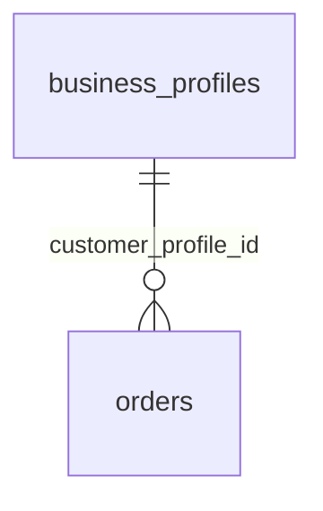

- 「`business_profiles` 1件に対し、`orders` は 0件以上」と読む。
- 逆向きには「`orders` 1件は、必ずちょうど1件の `business_profiles` に属する」と読む。
- 実線 `--` は、外部キーで直接つながっていることを表す。

カラムの横の記号:

| 記号 | 意味 |
|---|---|
| `PK` | 主キー |
| `FK` | 外部キー |
| `UK` | 一意制約（重複不可） |

---

## 3. 全テーブル共通のルール

`SPEC-100 §5〜§11` に基づく共通ルールを先に押さえると、各テーブルの説明が短く済む。

| ルール | 内容 | 理由 |
|---|---|---|
| スキーマ | 業務テーブルは `app` スキーマに置く。`public` スキーマには置かない | Supabase が管理する領域と混ざらないようにするため |
| 主キー `id` | `bigint` の自動採番（`GENERATED ALWAYS AS IDENTITY`）。通常は更新しない | 内部の結び付けに使う番号 |
| 公開用ID `public_ref` | `uuid`（ランダムな識別子）。主要なテーブルだけが持つ。重複不可 | URLやAPIでブラウザへ渡す用。連番の `id` は外へ出さない。**知っているだけでは権限にならない**（DB-ID-001） |
| 日時 | `timestamptz`（タイムゾーン付き）。DB接続はUTC、表示のときに `Asia/Tokyo` へ変換 | 日時のずれを防ぐ |
| 期間 | 「開始を含み、終了を含まない」`[開始, 終了)` | 15:00ちょうどの終わりと次の開始が重ならないようにするため |
| 金額 | `bigint` + 通貨コード（例 `JPY`）。小数（浮動小数点）は使わない | 金額の誤差を防ぐ |
| 状態（state） | PostgreSQL の enum は使わず、`text` + CHECK 制約で表す | 状態の追加・変更がやりやすいため |
| 作成・更新日時 | `created_at` / `updated_at`。作成日時はDB側で決める | クライアントの時刻を信用しない |
| 削除 | 注文、決済、チケット、受付などは**原則削除しない**。状態を変えて履歴を残す | お金・権利・受付の履歴を守るため |
| 外部キー | 履歴のあるデータは `ON DELETE RESTRICT`（親を消そうとしても、子がいれば拒否） | 親の削除で履歴が連鎖して消える事故を防ぐ |

---

## 4. 全体マップ（30テーブルの関係）

線だけを描いた全体図。まず「どの表がどの表とつながるか」を俯瞰する。カラムは省略している。

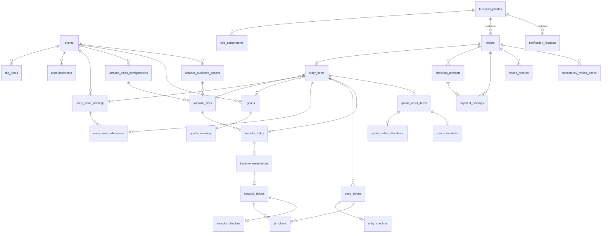

**この図の見どころ**

- 中心にあるのは `orders`（注文）と `order_items`（注文の明細）。入場券・カラオケ・グッズのどれを買っても、まずこの2つの表に記録される。
- 注文の先は、買ったものの種類で枝分かれする: 入場券 → `entry_tickets`、カラオケ → `karaoke_holds` → `karaoke_reservations` → `karaoke_tickets`、グッズ → `goods_order_items`。
- `webhook_receipts`（Stripeからの通知の受付記録）は、**外部キーを持たない独立した表**である。Stripeの識別子（文字列）で間接的に注文と照合するため、図には線がない。
- `consistency_review_cases` は、図の線以外にも、決済・予約・チケットなど多数の表を（任意で）指す。§5.9 で説明する。

---

## 5. 領域別 ER 図と解説

### 5.1 公開情報（イベント / FAQ / お知らせ）

ログインなしで誰でも見られる、イベントの案内情報。

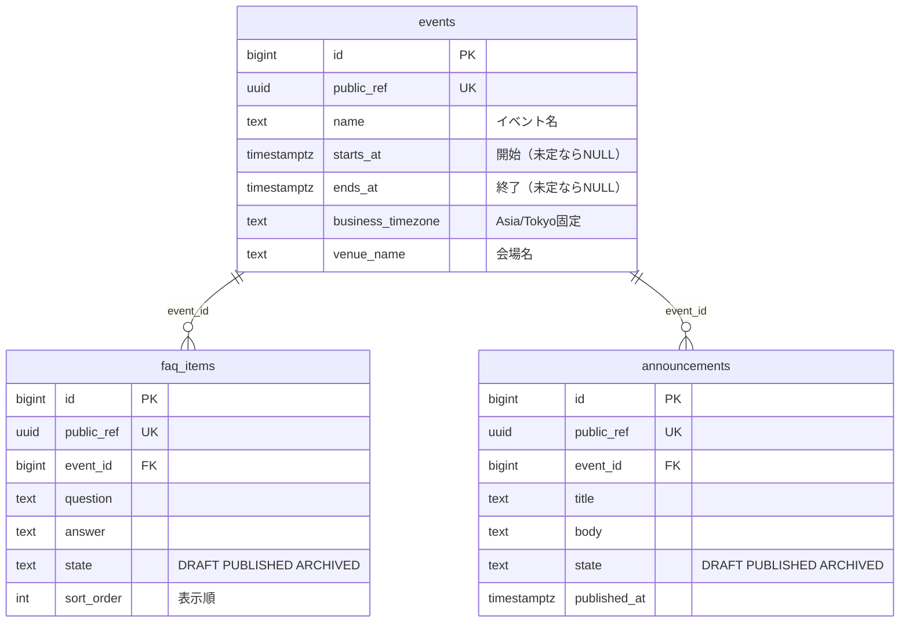

（`events` は他にも `summary`、`venue_details`、`access_information`、`participant_notices` を持つ。図では省略。）

| テーブル | 役割 | ポイント |
|---|---|---|
| `events` | イベント本体（名前、日時、会場など） | 日時は「未定」を許すため NULL 可。`starts_at < ends_at` を CHECK で守る。`business_timezone` は `Asia/Tokyo` 以外を入れられない |
| `faq_items` | よくある質問 | `state` が `PUBLISHED` のものだけを公開側に返す（DRAFT / ARCHIVED は返さない）。表示順は `sort_order` |
| `announcements` | お知らせ | 同上。新しい順に並べるため `published_at` を使う |

- 3つとも**削除せず**、`ARCHIVED`（保管）にして管理する。

### 5.2 ユーザーと権限

誰がログインしているか、どんな役割（スタッフ / 管理者）を持つか。

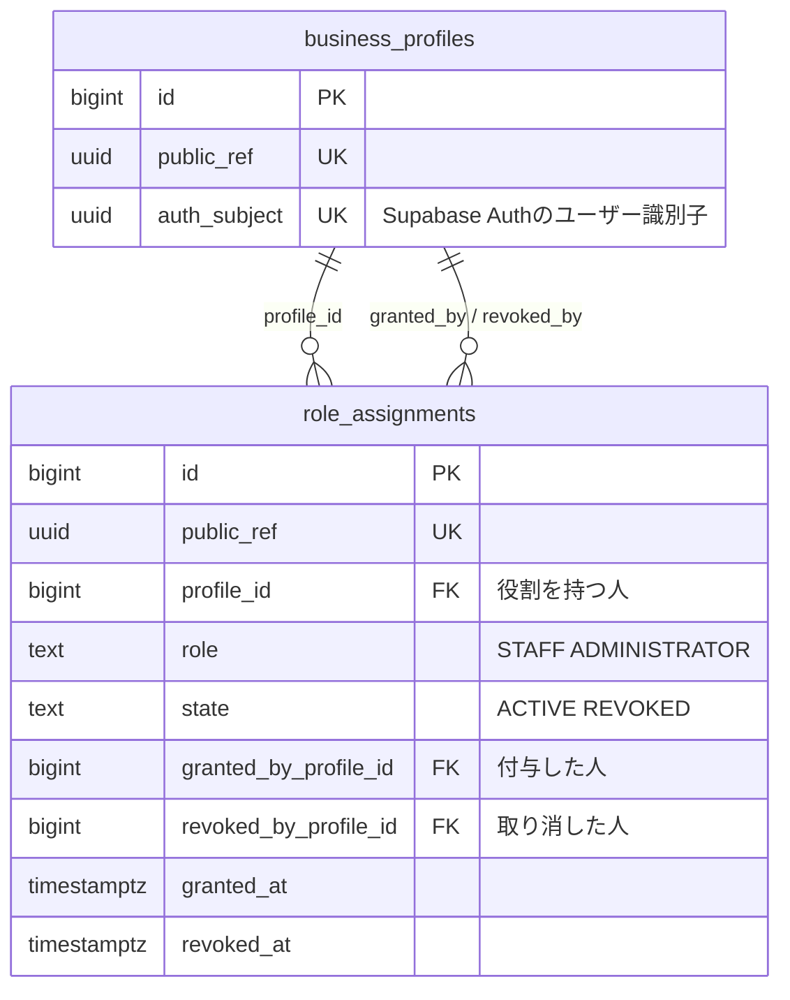

| テーブル | 役割 | ポイント |
|---|---|---|
| `business_profiles` | Supabase Authのログイン情報と、このシステムの「お客さん」を1対1で結び付ける | パスワード等は**一切持たない**（認証はSupabase Authの担当）。`auth_subject` に重複不可の制約があり、同じログイン者から2つのProfileができない。氏名や電話番号などの列は、現行仕様では**意図的に持たない** |
| `role_assignments` | 「誰が、いつ、どの役割（スタッフ / 管理者）を持ったか」の履歴 | 取り消しても行は消さず、`state` を `REVOKED` にする。同じ人に同じ役割が**有効（ACTIVE）なまま2件**できないよう、部分一意制約を使う（§6参照） |

- `business_profiles` から `role_assignments` への線が2本あるのは、同じ表が「役割を持つ人」「付与した人」「取り消した人」の3通りで `business_profiles` を指しているため。
- 一般のお客さんは `role_assignments` に行がない（役割なし）。
- 「最後の管理者がいなくなる」事故は、1行のチェックでは防げない。取り消し処理の中で、専用のロック（advisory lock）をかけて、有効な管理者の人数を数え直してから更新する。

### 5.3 販売設定（入場券 / カラオケ / グッズ）

「何を、いつから、いくらで、何個売るか」の設定。

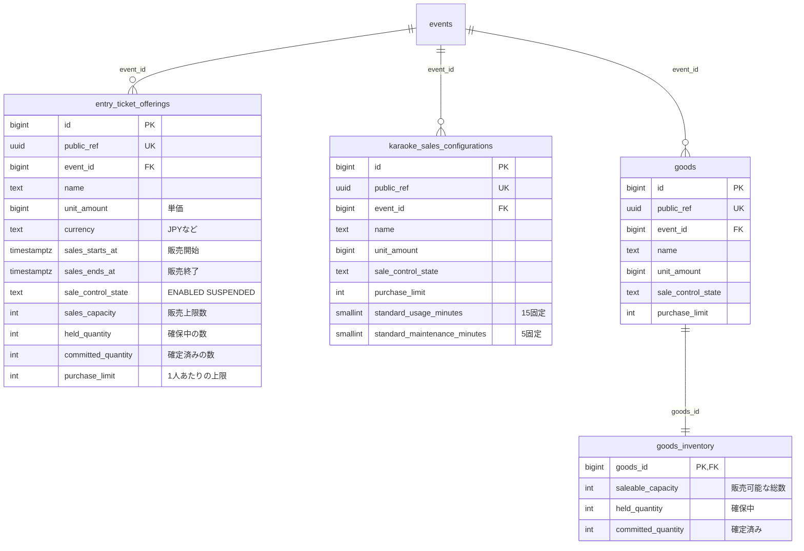

（販売期間 `sales_starts_at` / `sales_ends_at` と通貨 `currency` は、`karaoke_sales_configurations` と `goods` にもある。図では省略。入場券には入場受付の開始・終了時刻 `checkin_opens_at` / `checkin_closes_at` もある。）

| テーブル | 役割 | ポイント |
|---|---|---|
| `entry_ticket_offerings` | 入場券の商品設定 | `held_quantity + committed_quantity <= sales_capacity` を CHECK で必ず守る（売りすぎ防止の最終防衛線）。`sale_control_state` を `SUSPENDED` にすると、期間内でも販売を止められる |
| `karaoke_sales_configurations` | カラオケ枠の販売設定（価格・期間・1人あたり上限） | 標準は「利用15分 + 整備5分」。この値は CHECK で15・5に固定 |
| `goods` | グッズの商品設定 | 配送先や追跡番号の列は持たない（会場での受け渡しのみ） |
| `goods_inventory` | グッズの在庫数 | `goods` と**1対1**。主キーが `goods_id` そのもの。グッズを作るのと同じトランザクションで必ず1行作る |

#### 「在庫カウンタ」とは

`held_quantity`（確保中）と `committed_quantity`（確定済み）は、売れ行きを数えるメモである。

```text
販売上限 10 のとき
  確保中 3 + 確定済み 5 = 8  → あと 2 枚買える
  確保中 3 + 確定済み 8 = 11 → ありえない（CHECKで拒否される）
```

- 「確保中」は、注文は作ったが、まだ支払いが済んでいない数。
- 支払いが完了すると「確保中 → 確定済み」に移り、期限切れなら「確保中」を減らして枠を戻す。
- このカウンタは**現在の合計を持つだけ**であり、履歴は §5.4 の「確保（Allocation）」の表が持つ。

### 5.4 注文と在庫確保

入場券・カラオケ・グッズのどれを買っても、最初に作られる記録。

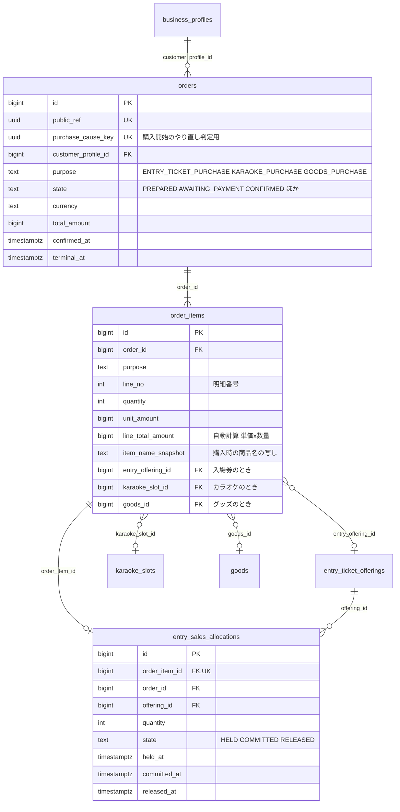

#### orders（注文）と order_items（注文の明細）

- **1つの注文は、1つの目的（purpose）だけ**を持つ。入場券とグッズを同時に買うことはできず、別々の注文になる。
- 注文の `state`（状態）は次の7種類:

| state | 意味 |
|---|---|
| `PREPARED` | 注文を作った直後（在庫は確保済み、まだ決済画面へ進んでいない） |
| `AWAITING_PAYMENT` | 決済画面を発行し、支払い待ち |
| `CONFIRMED` | 支払いが確認され、購入が確定した |
| `PAYMENT_FAILED` | 支払いに失敗した |
| `CANCELED` | キャンセルされた |
| `EXPIRED` | 支払期限が切れた |
| `REVIEW_REQUIRED` | 状況が食い違い、人が確認する必要がある |

- `CONFIRMED` のときだけ `confirmed_at` が入り、`PAYMENT_FAILED` / `CANCELED` / `EXPIRED` のときは `terminal_at` が入る（CHECK制約で保証）。
- 注文の作成後、**お客さん・目的・通貨・合計金額は変更しない**。
- `order_items` の `line_total_amount` は、DBが「単価 × 数量」を自動計算する（`GENERATED` 列）。人が直接入れることはできない。
- `item_name_snapshot` や `unit_amount` は**購入時点の写し（スナップショット）**。あとで商品名や価格が変わっても、過去の注文は変わらない。

#### 「どれか1つだけ」を守る仕組み

`order_items` は `entry_offering_id` / `karaoke_slot_id` / `goods_id` の3つの外部キーを持つが、**使うのは目的に応じた1つだけ**で、残りは NULL にする。これを CHECK 制約で強制している。

| 注文の目的 | `entry_offering_id` | `karaoke_slot_id` | `goods_id` | 追加ルール |
|---|:-:|:-:|:-:|---|
| 入場券 | 入る | NULL | NULL | - |
| カラオケ | NULL | 入る | NULL | 数量は必ず1 |
| グッズ | NULL | NULL | 入る | - |

#### entry_sales_allocations（入場券の確保記録）

- 「どの注文明細が、どの入場券商品の枠を、何枚確保したか」の記録。`order_items` と1対1（`order_item_id` が重複不可）。
- 状態は `HELD`（確保中）→ `COMMITTED`（確定）または `RELEASED`（解放）。**一度 `COMMITTED` / `RELEASED` になったら `HELD` へは戻さない**。
- 枠の確保は、商品の行（`entry_ticket_offerings`）をロックしてから、カウンタの更新と同じトランザクションで行う。

### 5.5 決済

Stripe（外部の決済サービス）とのやり取りの記録。**支払いの確定は、Stripeから届く検証済みのWebhookだけを根拠にする**。ブラウザの「成功しました」画面への遷移では確定しない。

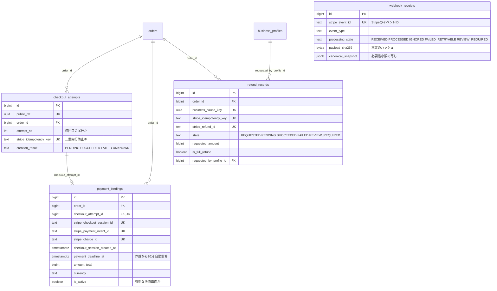

| テーブル | 役割 | ポイント |
|---|---|---|
| `checkout_attempts` | 「Stripeの決済画面（Checkout Session）を作ろうとした」試行の記録 | 通信が途中で切れて結果が不明でも、**同じ試行・同じ `stripe_idempotency_key` で再実行**する。盲目的にやり直して二重に作らないための鍵。`creation_result` は注文の状態ではなく、Stripe呼び出しの結果分類 |
| `payment_bindings` | 注文とStripeの決済IDを結び付ける | Session ID / PaymentIntent ID / Charge ID は、**複数の注文に結び付けられない**（一意制約）。有効（`is_active`）な決済は、注文1件につき最大1つ（部分一意制約）。支払期限（`payment_deadline_at`）は作成から30分で、DBが自動計算する |
| `webhook_receipts` | Stripeから届いた通知の受付記録 | `stripe_event_id` が一意なので、同じ通知が2回届いても重複処理しない。**生の本文は保存しない**（個人情報・カード関連情報を持たないため）。照合に必要な最小限だけを `canonical_snapshot` に残す。外部キーは持たない |
| `refund_records` | 返金の記録 | 金額・通貨はサーバー側が決める（クライアントの金額は使わない）。「全額返金」は、有効なものが1件までに制限される（部分一意制約） |

- Stripe呼び出しはDBトランザクションの**外**で行う。結果が不明なときは、同じ業務上の原因（business cause）・同じキーで照合する。

### 5.6 入場券・QR・受付

支払い確定後に発行される入場券と、会場でのQR受付。

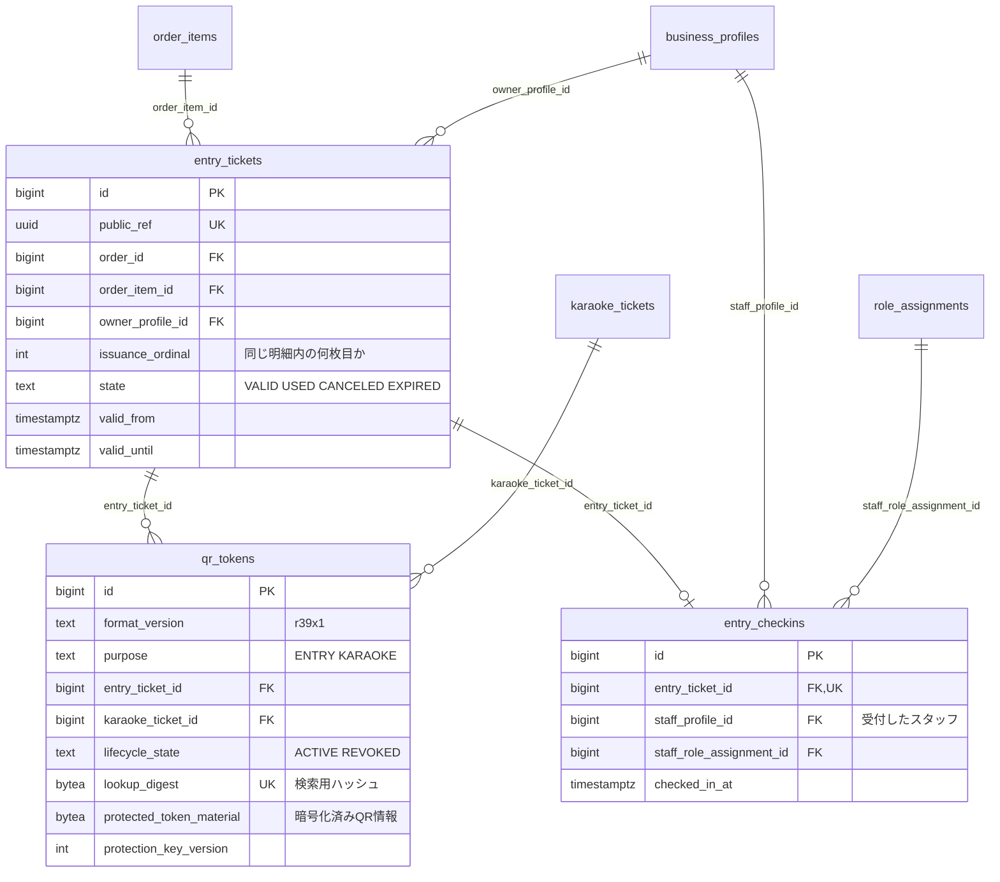

| テーブル | 役割 | ポイント |
|---|---|---|
| `entry_tickets` | 入場券1枚ごとの行 | 数量 N の購入なら、`issuance_ordinal` が 1〜N の N 行が作られる。同じ明細内で番号が重複しないよう一意制約がある。持ち主（`owner_profile_id`）は注文のお客さんと同じ人であることを、複合外部キーでDBが保証する |
| `qr_tokens` | 入場券・カラオケ券に付くQRの記録 | **QR本体（平文）は保存しない**。検索用のハッシュ（`lookup_digest`）と、アプリ側で暗号化したデータだけを持つ。入場用（ENTRY）とカラオケ用（KARAOKE）で目的を分けている |
| `entry_checkins` | 入場受付の記録 | 1枚の入場券につき**最大1件**（`entry_ticket_id` が一意）。受付した後に更新・削除しない |

#### QRトークンの「どちらか一方だけ」

`qr_tokens` は入場券とカラオケ券のどちらかに属する。`purpose = ENTRY` なら `entry_ticket_id` だけ、`KARAOKE` なら `karaoke_ticket_id` だけが入り、もう一方は必ず NULL になる（CHECK制約）。1枚のチケットに有効な（`ACTIVE`）QRは最大1つ（部分一意制約）。

#### 受付が「1回だけ」成功する仕組み

1. チケットの行をロックする（同時に別の受付が来ても順番待ちになる）。
2. 状態が `VALID` のときだけ `USED` に更新する。
3. 更新できたときだけ `entry_checkins` に1行追加する。
4. どちらかが失敗したら全体を取り消す。
5. 仮に2件目を入れようとしても、`entry_ticket_id` の一意制約で拒否される（最後の防御）。

### 5.7 カラオケ

時間枠（Slot）を取り合う、いちばん競合しやすい領域。

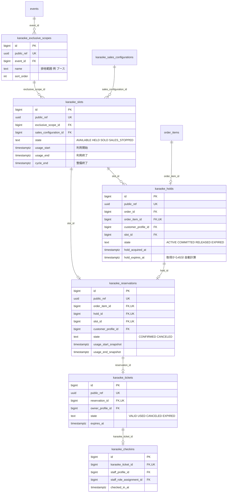

#### 用語

| 用語 | 意味 |
|---|---|
| Exclusive Scope（排他範囲） | 「同じ時間に1組しか使えない」範囲（例: 1つのカラオケブース）。時間枠の重なりチェックはこの単位で行う |
| Slot（枠） | 1つの時間枠。利用15分 + 整備5分が標準で、`usage_start`〜`usage_end`が利用、`usage_end`〜`cycle_end`が整備 |
| Hold（仮押さえ） | 決済が済むまで、枠を一時的に押さえる記録。**取得から45分**で失効する（DBが自動計算） |
| Reservation（予約） | 支払い確定後の正式な予約。購入時の利用時間を写し（スナップショット）として持つ |
| Ticket（カラオケ券） | 予約に対して発行される券。QRで受付する |

#### 枠の状態の流れ

```text
AVAILABLE（購入可能）
   │ 購入を開始（Holdを作る）
   ▼
HELD（仮押さえ中）  ── 45分以内に支払いなし ──► AVAILABLE へ戻る（Holdは EXPIRED / RELEASED）
   │ 支払い確定
   ▼
SOLD（売却済み）
```

- 運営が止めた枠は `SALES_STOPPED`。
- 予約をキャンセルしても、**枠は `SOLD` のまま**で `AVAILABLE` に戻さない（`DB-KRK-018`）。Holdも `COMMITTED` のまま変えない。

#### 時間の重なりを防ぐ仕組み

同じ排他範囲の中で、利用時間 + 整備時間（`[usage_start, cycle_end)`）が重なる枠は、**DBが登録を拒否する**（`EXCLUDE USING gist` 制約）。アプリ側の「先に確認してから登録」だけに頼らない。`cycle_end` と次の `usage_start` が同時刻なら、重なりとは見なさない（終了を含まない期間のため）。枠の状態（`SOLD` など）に関係なく、全ての枠が対象になる。

#### 「1つの枠に、同時に押さえられる人は1人だけ」の守り方

- 枠の行をロックし、条件付きで `AVAILABLE → HELD` に更新する。
- さらに、`karaoke_holds` に「`state = 'ACTIVE'` のとき `slot_id` は重複不可」という部分一意制約がある。
- 同時に2人が押さえにきても、勝つのは最大1人。負けた側の注文や明細は、**途中まで作られた状態で残らない**（全体が取り消される）。

#### Reservation が Hold と一致することの保証

`karaoke_reservations` は、`karaoke_holds` を複合外部キー（5つの列の組）で指している。これにより、予約の「お客さん」「枠」「注文明細」が、Hold のものと**必ず一致**する。

### 5.8 グッズ

会場での手渡しで受け渡すグッズ。

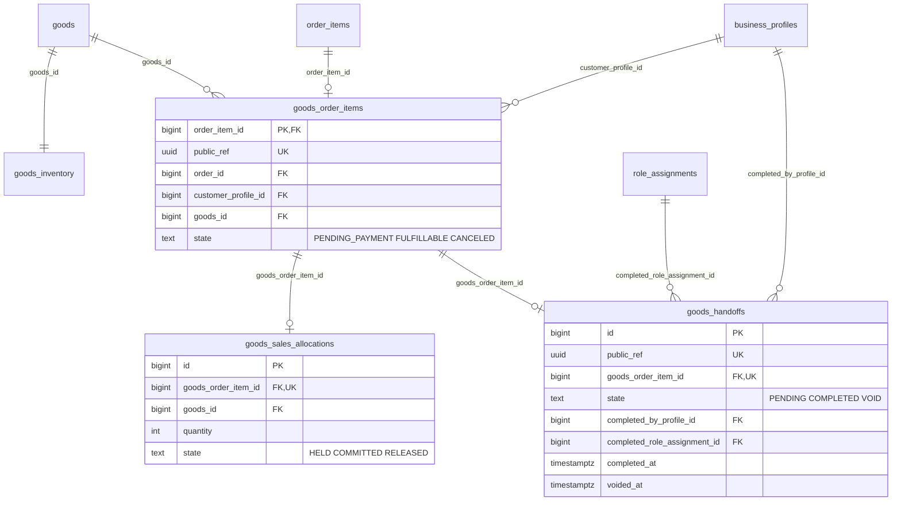

| テーブル | 役割 | ポイント |
|---|---|---|
| `goods_order_items` | `order_items` の「グッズ版の追加情報」 | `order_items` と1対1。主キーが `order_item_id` 自体で、「基本の明細に、グッズ専用の列を足した表」と考えるとよい。お客さんが注文のお客さんと一致することを複合外部キーで保証 |
| `goods_sales_allocations` | グッズ在庫の確保記録 | 入場券の `entry_sales_allocations` と同じ考え方。`goods_inventory` の行をロックし、カウンタと同時に更新する |
| `goods_handoffs` | 会場での手渡しの記録 | 明細1件につき1件。購入開始時に `PENDING` で同時に作る。`COMPLETED` になった行は、`PENDING` に戻さず、更新も削除もしない。手渡しの完了にはスタッフの記録が必要 |

### 5.9 通知と整合性レビュー

業務の本流ではなく、「メール送信の管理」と「食い違いの追跡」を担う補助的な表。

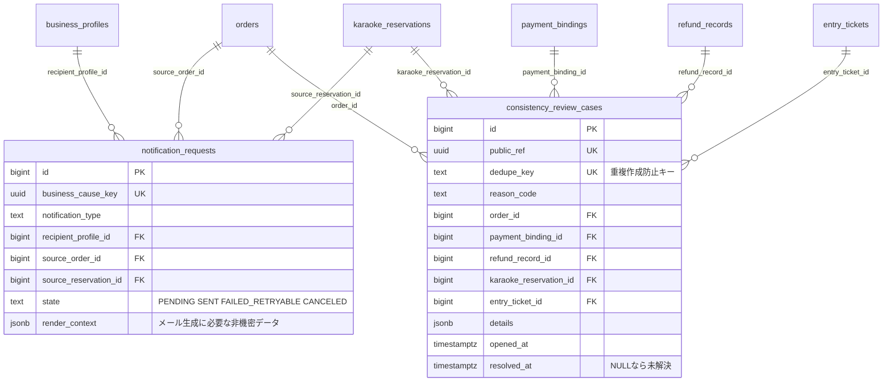

（`consistency_review_cases` は、図以外にも `checkout_attempt_id` / `karaoke_slot_id` / `karaoke_hold_id` / `karaoke_ticket_id` / `goods_order_item_id` を指せる。線が多くなるため省略した。）

| テーブル | 役割 | ポイント |
|---|---|---|
| `notification_requests` | 「このお客さんにこの通知を送る」という依頼の記録 | `business_cause_key` が一意なので、再試行しても同じ行を更新し、通知が二重に作られない。送信の再試行が、元の注文や予約をもう一度確定させることはない。注文または予約のどちらか一方は必ず指す（CHECK） |
| `consistency_review_cases` | 「支払ったのに在庫がなかった」のような**食い違いを、人が確認するために記録する**表 | 指す先（注文、決済、チケットなど）のうち、少なくとも1つは入る（CHECK）。`resolved_at` が NULL なら未解決。解決しても、原因となった記録は消さない。`dedupe_key` で同じ食い違いの重複作成を防ぐ |

- 監査ログ（誰がいつ何をしたかの汎用ログ）の表は、`SPEC-100` では**作らない**。`SPEC-160` が、後から別の表として追加する。

---

## 6. このDBが「事故を防ぐ」ための工夫

アプリのコードだけに頼らず、**DB自身が最後の防衛線になる**設計になっている。主な工夫を、初心者向けにまとめる。

| 工夫 | 何を防ぐか | 実際の例 |
|---|---|---|
| **CHECK 制約** | 不正な値の登録 | `quantity > 0`、`held_quantity + committed_quantity <= sales_capacity` |
| **一意制約（UNIQUE）** | 同じものの二重登録 | `webhook_receipts.stripe_event_id`、`entry_checkins.entry_ticket_id` |
| **部分一意制約**（条件付きUNIQUE） | 「有効なものだけ」を1件に制限 | 同じ枠に `ACTIVE` な Hold は1件、注文に有効な決済は1件、同じ人に有効な同じ役割は1件 |
| **複合外部キー**（複数列で参照） | 親子で「持ち主」や「種別」がずれること | 入場券の持ち主 = 注文のお客さん。予約の枠 = Hold の枠 |
| **EXCLUDE 制約**（重なり禁止） | 時間枠の二重予約 | 同じ排他範囲での時間帯の重複 |
| **自動計算列（GENERATED）** | 人為的な計算ミス・改ざん | 行の合計金額、決済期限（30分）、Hold の期限（45分） |
| **行ロック（`FOR UPDATE`）** | 同時購入での売りすぎ | 最後の1枚を2人が同時に買う |
| **条件付き更新** | 状態の巻き戻し・二重処理 | `UPDATE ... WHERE state = 'HELD'` が1行更新できたときだけ、カウンタを動かす |
| **スナップショット** | 後から価格や商品名が変わっても、過去が変わらない | `item_name_snapshot`、`usage_start_snapshot` |
| **冪等キー（二重実行防止キー）** | 通信失敗後の再試行で二重に処理 | `purchase_cause_key`、`stripe_idempotency_key`、`business_cause_key` |
| **ON DELETE RESTRICT / 削除しない方針** | お金・権利・受付の履歴が消えること | 注文・決済・チケット・受付は削除しない |

### 「なぜ DB に任せるのか」の例

「最後の1枚」を2人が同時に買おうとする場合を考える。

```text
アプリだけで守る場合:
  Aさん: 残り1枚と確認 ─┐
  Bさん: 残り1枚と確認 ─┤ ← 両方が「買える」と判断
  Aさん: 購入 ──────────┤
  Bさん: 購入 ──────────┘ → 売りすぎ！

このDBの場合:
  Aさん: 商品の行をロック → 確認 → カウンタ+1 → 確定
  Bさん: ロック待ち ...
         Aさんの確定後にロックを取得 → 残り0枚と判明 → 購入失敗
  （万一ロックを忘れても、CHECK 制約が「売りすぎ」の登録を拒否する）
```

---

## 7. 購入から受付までのデータの流れ（具体例）

「入場券を2枚買って、会場で受付する」場合に、どの表がどう変わるか。

| 手順 | 何が起きるか | 作成・更新される表 |
|---|---|---|
| 1 | Aさんがログイン。初回なら、Supabase Authのユーザー識別子と結び付く Profile が作られる | `business_profiles`（`auth_subject` が重複不可なので、同時リクエストでも1件） |
| 2 | 購入を開始（2枚）。1つのトランザクションで、枠の確認と同時に在庫を確保 | `orders`（`PREPARED`）、`order_items`（数量2）、`entry_sales_allocations`（`HELD`）、`entry_ticket_offerings.held_quantity` +2 |
| 3 | Stripeの決済画面を発行 | `checkout_attempts`、`payment_bindings`、`orders`（`AWAITING_PAYMENT`） |
| 4 | Aさんが支払う。Stripeから Webhook が届く | `webhook_receipts`（`RECEIVED`） |
| 5 | Webhookを検証し、**同じトランザクション内で**購入を確定 | `orders`（`CONFIRMED`）、`entry_sales_allocations`（`COMMITTED`）、カウンタ `held` -2 / `committed` +2、`entry_tickets`（2行、ordinal 1・2、`VALID`）、`qr_tokens`（2行）、`webhook_receipts`（`PROCESSED`）、`notification_requests`（購入完了メール） |
| 6 | 会場でスタッフがQRを読み取る | `entry_tickets`（`VALID` → `USED`）、`entry_checkins`（1行追加） |
| 7 | 同じQRをもう一度読み取る | 状態が `USED` のため、既存の受付記録を返すだけで、新しい行は作らない |

支払いの期限が切れた場合は、手順5の代わりに `orders` が `EXPIRED`、`entry_sales_allocations` が `RELEASED` になり、カウンタの `held` が減って枠が戻る。

---

## 8. DBに「ない」もの・注意点

| 項目 | 内容 |
|---|---|
| ログイン情報（パスワード等） | **Business Database には保存しない**。Supabase Auth が管理する。`business_profiles.auth_subject` は `auth.users` への外部キーも張らない（認証側の削除が業務履歴に波及しないため） |
| QRの平文 | 保存しない。検索用ハッシュと暗号化済みデータのみ |
| Stripeの生Webhook本文 | 保存しない。必要最小限の写しだけを `canonical_snapshot` に持つ |
| 氏名・電話・住所 | 現行の `business_profiles` には**ない**。表示名（Display name）は、**未反映の変更要求 `UCR-100-001`** で検討中。正式な仕様に反映されるまで、実装の根拠にしない |
| 汎用の監査ログ表 | `SPEC-100` では作らない（`SPEC-160` が後から追加する） |
| PostgreSQLのenum型 | 使わない。`text` + CHECK で表す |
| 保留中のindex | `UCR-130-005`（運用向けの検索index）は保留中。先回りして追加しない |
| 実装状況 | 現在のリポジトリは仕様書のみで、migration / スキーマのコードはまだない。この図は**計画上の設計**である |

---

## 9. 用語集

| 用語 | 意味 |
|---|---|
| Allocation（確保） | 在庫や販売枠を、注文のために押さえた記録 |
| Business Cause（業務上の原因） | 「同じ依頼の再試行」を見分けるための識別子。二重実行の防止に使う |
| Check-in（受付） | 会場で、チケットを使って入場・利用を確認すること |
| Checkout Session | Stripeが用意する決済画面 |
| Composite FK（複合外部キー） | 複数の列の組で、別の表を指す外部キー |
| Counter（カウンタ） | 在庫の「確保中」「確定済み」の現在の合計を持つ列 |
| Hold（仮押さえ） | 支払いが済むまで、枠を一時的に押さえること |
| Idempotency（冪等性） | 同じ操作を何度繰り返しても、結果が1回分と同じになる性質 |
| Partial unique（部分一意制約） | 条件を満たす行の間だけで、重複を禁止する制約 |
| Public Reference（`public_ref`） | ブラウザやAPIに渡す、推測されにくい公開用のID |
| Snapshot（スナップショット） | 購入や確定の時点の値を、写して保存したもの |
| System of Record | そのデータの「正本」を持つ場所。認証はSupabase Auth、業務データはPostgreSQL、決済の確定はStripe |
| Webhook | Stripeなどの外部サービスが、出来事（支払い完了など）をこちらへ知らせてくる通知 |

---

## 参考: 主要な仕様書の参照先

- テーブル定義の正: `SPEC-100 Database Design`
- ドメインの状態・ルール: `SPEC-030`
- 認証・権限: `SPEC-060`
- 注文・決済: `SPEC-070`
- 入場券・QR・受付: `SPEC-080`
- カラオケ: `SPEC-090`
